  

  

## 🚀 Featured Builds

| | Project | What it does | Stack |
|:-:|:--|:--|:--|
| 🪑 | **[組みTalk](https://github.com/ebaoacho/KumiTalk)** 🏆 JPHacks 三菱重工賞 · SecureCycle賞 | 家具の説明書PDFをアップすると、平易な手順・**パーツ色分け画像**・手順ごとのAIチャットに変換 | Next.js · Supabase · Gemini 2.5 |
| 🍜 | **[飯ロワイヤル](https://github.com/ImaKento/Meshi-Royale)** 🏆 RSS Hackathon 2025 審査員特別賞 | 「どこで食べる？」をミニゲームで決着。最大4人のリアルタイム対戦 → 勝者の条件で店を自動選択 | Next.js 15 · Supabase Realtime · Prisma |
| 📱 | **[Settee](https://github.com/ebaoacho/Settee)** | 位置情報ベースのマッチングアプリ。1対1／グループ、空き日程カレンダー、チャット、サブスク課金まで | Flutter · Django REST · PostgreSQL · Docker |
| 🍽️ | **[KichiKichi Reservation](https://github.com/ebaoacho/KichiKichi-Paid-Reservation)** | 実店舗向けの予約・決済システム。仮押さえ＋**行ロックで二重予約を防止**、冪等なStripe決済 | PHP · WordPress · Stripe · MySQL |

## 🔬 Research

<table>
<tr>
<td width="33%" valign="top">

### 🎯 Small Object Detection
小さく・速く・隠れやすい対象を、撮影環境の違いに左右されず検出する。人の修正を学習に還元する **Human-in-the-loop** なワークフローも設計。

`YOLO` · `PyTorch` · `HITL`

</td>
<td width="33%" valign="top">

### 🎥 Video Understanding
物体検出と人物検出を統合し、映像の中で「誰が・何に関わっているか」をフレーム単位で推定。スポーツ映像を題材に研究中。

`Detection` · `Tracking` · `Interaction`

</td>
<td width="33%" valign="top">

### 📈 Time-series Analysis
多次元の時系列データから状態の切り替わりを自動検出する可視化システム（PELT + BIC）。

`Change-point` · `Visualization`

</td>
</tr>
</table>

📝 人工知能学会 論文誌 / スポーツ情報学研究会 ほか 
🧱 MLS点群の地物識別（KPConv）で家・ブロック塀・車などを分類し、そこからブロック塀を精緻に抽出するアルゴリズムを研究　·　🚇 下水管点検映像の処理

## 🧰 Tech Stack

  

## 📊 Activity

  

  

  

